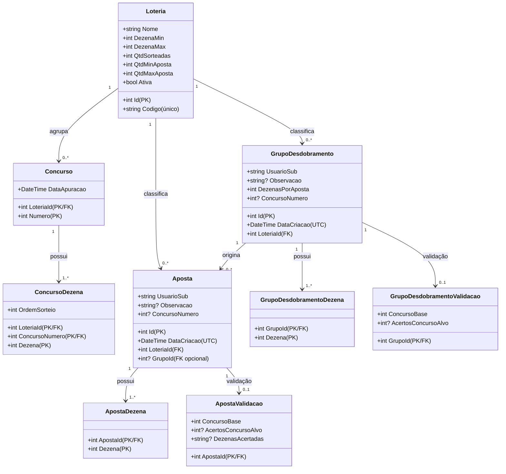
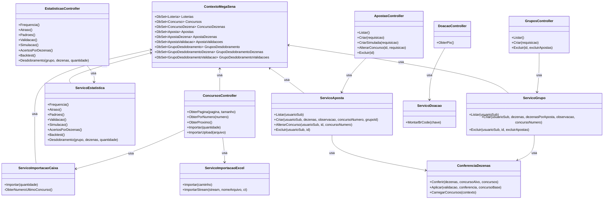
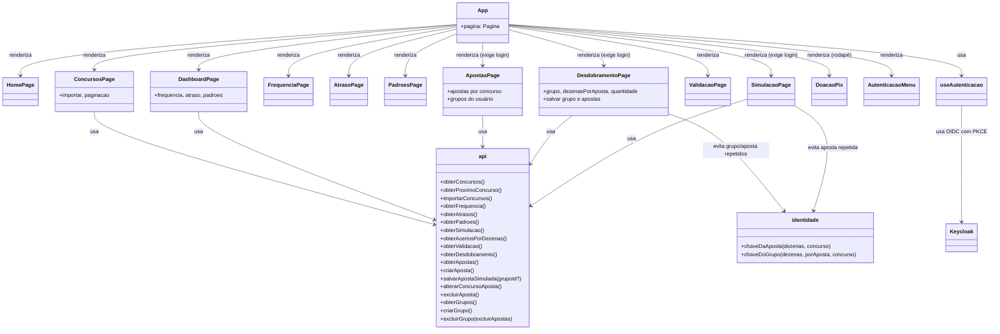
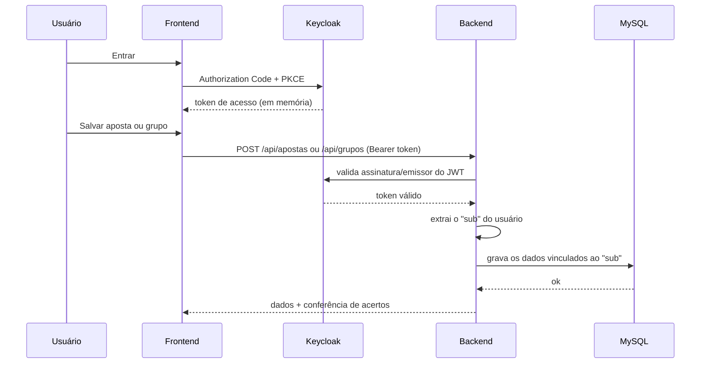

# UML

Diagramas do Análise Jogos Caixa (Mermaid). Mostram as entidades, as classes
principais de cada camada e o relacionamento entre elas, sem detalhar a
implementação.

## Modelo de dados

O número do concurso é único por loteria (`LoteriaId + Numero`). As chaves
compostas nas tabelas de dezenas impedem repetições dentro do concurso, da aposta
ou do grupo. A associação entre grupo e aposta também é validada por usuário e
loteria.

## Backend

## Frontend

## Autenticação e dados do usuário

